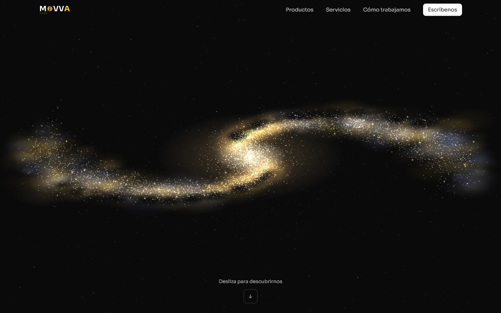
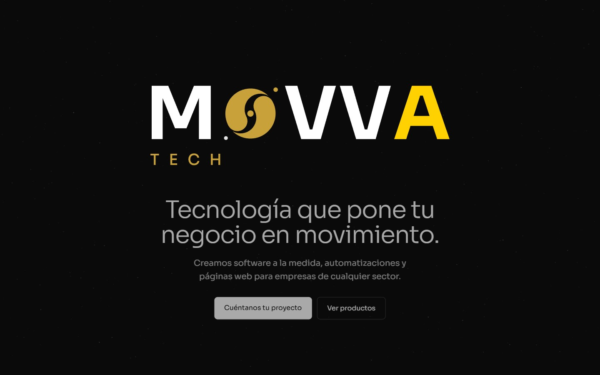
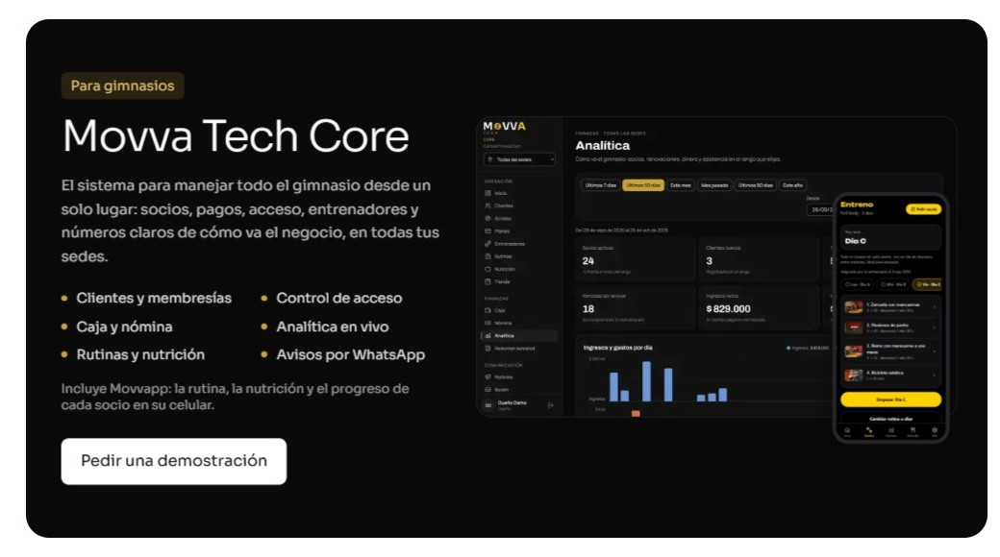
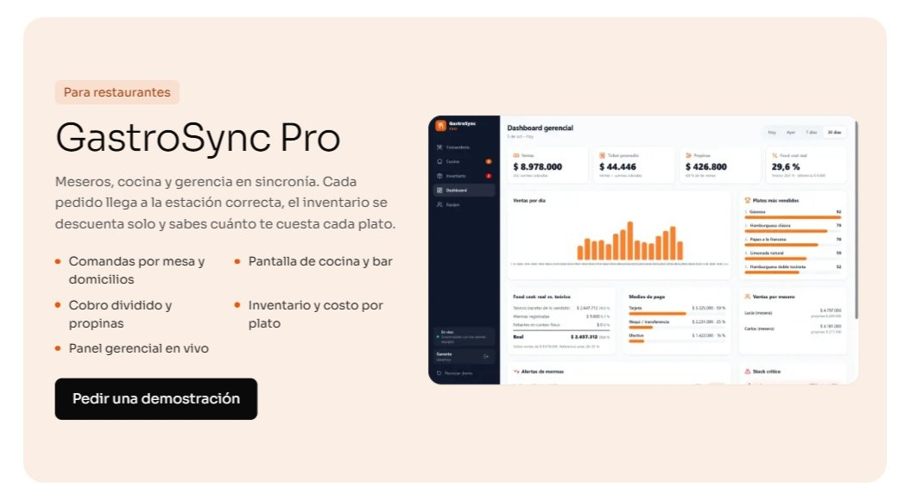

  

## Hola, soy Miguel 👋

Hago software para negocios: sistemas de venta, inventario y gestión que se usan todos los días en el mostrador, la cocina o la recepción. Trabajo en todo el producto, desde la base de datos hasta la app móvil y la web.

---

### 🛠️ Lo que construyo

| Proyecto | Qué hace | Tecnologías |
|---|---|---|
| **GastroSync Pro** | POS para restaurantes con pantalla de cocina (KDS), inventario y roles por empleado | Next.js · PostgreSQL |
| **ERP comercial** | Ventas, bodega e inventario para tiendas de perfumería y suplementos | Next.js · TypeScript · CI |
| **Plataforma para gimnasios** | Gestión de socios, pagos y recepción, con app móvil para los socios | Next.js · Prisma · React Native |
| **Sitios web para negocios** | Webs para floristería, perfumería y servicio de grúas | Next.js · GSAP |

> Casi todos mis repos son privados porque son de clientes. Si quieres ver algo, escríbeme y te muestro una demo.

---

### 🖼️ Movva Tech en imágenes

  
  

  
  

---

### 🧰 Tecnologías

  

**Móvil:** React Native + Expo &nbsp;·&nbsp; **Animación:** GSAP &nbsp;·&nbsp; **Datos:** PostgreSQL, MariaDB, Prisma
